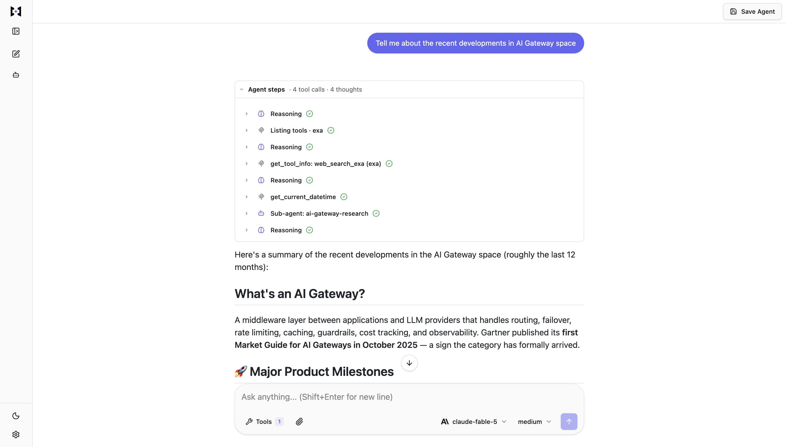
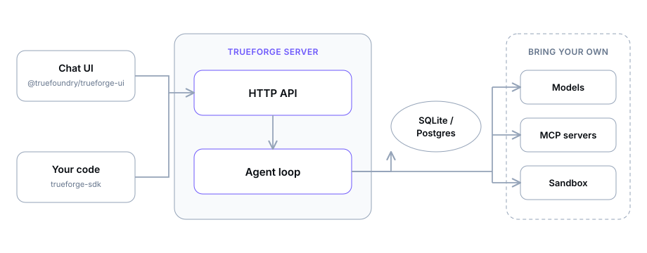

> **[中文化] trueforge**
>
> 此项目是 [truefoundry/trueforge](https://github.com/truefoundry/trueforge) 的中文翻译版本。
> - 原项目 Stars: 0
> - 主语言: 
> - 许可证: 
> - 翻译日期: 2026-09-03
> - 原始 README: [README_en.md](README_en.md)
>
> 如有翻译不准确之处，欢迎提 Issue 或 PR。

---


---

<p align="center">
  <a href="https://trueforge.dev">
    <picture>
      <source srcset="./docs/assets/trueforge-black.svg" media="(prefers-color-scheme: light)">
      <source srcset="./docs/assets/trueforge-white.svg" media="(prefers-color-scheme: dark)">
      
    </picture>
  </a>
</p>
<p align="center">开源智能体框架——将 LLM 转化为可用智能体的运行时层</p>

<p align="center">
  <a href="https://trendshift.io/repositories/155463?utm_source=trendshift-badge&amp;utm_medium=badge&amp;utm_campaign=badge-trendshift-155463" target="_blank" rel="noopener noreferrer"></a>
</p>

<p align="center">
  <a href="https://github.com/truefoundry/trueforge/blob/main/LICENSE"></a>
  <a href="https://nodejs.org">= 22.14"></a>
  <a href="https://trueforge.dev"></a>
  <a href="https://trueforge.dev/quickstart"></a>
  <a href="https://trueforge.dev/api/overview"></a>
</p>
<p align="center">
  <a href="https://www.npmjs.com/package/@truefoundry/trueforge"></a>
  <a href="https://www.npmjs.com/package/@truefoundry/trueforge-sdk"></a>
  <a href="https://www.npmjs.com/package/@truefoundry/trueforge-ui"></a>
  <a href="https://www.npmjs.com/package/@truefoundry/trueforge-core"></a>
  <a href="https://tfy.jfrog.io/ui/packages/oci:%2F%2Ftrueforge"></a>
  <a href="https://deepwiki.com/truefoundry/trueforge"></a>
</p>

# TrueForge

TrueForge 为您运行智能体执行循环——模型调用、MCP 工具、技能、沙箱、审批、上下文管理和会话状态——并通过三种方式暴露：**聊天 UI**、带 TypeScript **SDK** 的 **HTTP API**，以及可嵌入的 **UI SDK**。



## 为什么选择 TrueForge？

构建一个智能体很容易。但运行好一个智能体却并非易事——您需要流式传输、会话持久化、工具服务器、沙箱、审批和 UI。TrueForge 开箱即用地为您提供这一切：

- **从目录进行初始设置** - 配置一次[模型](https://trueforge.dev/models)、[MCP 服务器](https://trueforge.dev/mcp-servers)、[技能](https://trueforge.dev/skills)和[沙箱](https://trueforge.dev/sandbox)；智能体从您已连接的内容中进行选择。预设来自随附的 YAML 目录，您可以自定义。
- **任意模型提供商** - OpenAI、Anthropic、Google Gemini 及其他目录提供商，或任何兼容 OpenAI 的端点。
- **MCP 工具** - 支持 Header 认证或 OAuth 的远程 MCP 服务器，包括聊天内授权。
- **技能** - 基于 Git 的 `SKILL.md` 指令包，按需在沙箱中加载。
- **沙箱即工具** - 隔离的代码/文件执行（目前为 Daytona；计划支持更多提供商），仅在需要时配置。密钥保留在框架中。
- **人工检查点** - 工具审批、向用户提问以及聊天中的生成式 UI。
- **上下文工程** - 子智能体、延迟工具加载、代码模式、大结果卸载和压缩。
- **聊天 UI + SDK** - 使用内置 UI，通过 `@truefoundry/trueforge-sdk` 实现自动化，或嵌入 `@truefoundry/trueforge-ui`。

它支持灵活伸缩：**本地模式**（单进程，SQLite）或**托管模式**（Postgres + Redis，Docker Compose、Helm 或 Railway）。

## 快速开始

### 使用 `npx` 快速启动

```
npx @truefoundry/trueforge@latest
```

参考[快速入门](https://trueforge.dev/quickstart)指南，使用各种方法（本地、Docker Compose、Kubernetes 或 Railway）运行 TrueForge。连接模型、工具、技能，构建您的第一个可复用智能体。

要从本仓库开发 TrueForge，请参阅 [CONTRIBUTING.md](CONTRIBUTING.md)。

## 架构

<p align="center">
  <picture>
    <source srcset="./docs/assets/architecture-dark.svg" media="(prefers-color-scheme: dark)">
    <source srcset="./docs/assets/architecture-light.svg" media="(prefers-color-scheme: light)">
    
  </picture>
</p>

| 模式   | 最适合场景                    | 存储     | 额外基础设施      | 运行方式                             |
| ------ | --------------------------- | -------- | ---------------- | -------------------------------- |
| 本地  | 个人使用、试用 | SQLite   | 无             | `npx @truefoundry/trueforge`     |
| 托管 | 团队、多副本        | Postgres | Postgres + Redis | Docker Compose、Helm 或 Railway |

> **本地模式仅适用于您的个人机器。** 它是试用 TrueForge 的便捷方式——并非生产或面向互联网的配置。默认情况下没有登录，数据存储在本地 SQLite 文件中。请将其保持在 localhost。如果超出此范围使用本地模式，我们无法对数据丢失或未经授权的访问承担责任。对于共享或生产部署，请使用托管模式。

## 文档

| 章节                                                             | 内容概述                                                  |
| ------------------------------------------------------------------- | ----------------------------------------------------------------- |
| [简介](https://trueforge.dev/introduction)                  | 什么是智能体框架以及 TrueForge 如何整合          |
| [快速入门](https://trueforge.dev/quickstart)                      | 本地或托管运行，构建您的第一个智能体                       |
| [初始设置](https://trueforge.dev/harness/initial-setup)        | 模型、MCP、技能、沙箱 - 目录和覆盖项             |
| [创建智能体](https://trueforge.dev/create-agent/overview)      | 选择资源；工具审批、提问、生成式 UI         |
| [框架能力](https://trueforge.dev/key-features/overview) | 沙箱即工具、子智能体、延迟工具、代码模式、压缩 |
| [设置登录](https://trueforge.dev/authentication/overview)        | 共享部署的可选 OIDC                              |
| [基准测试](https://trueforge.dev/benchmarking)                  | 与 Claude Managed Agents 和 deepagents 的成本/准确性对比             |
| [SDK](https://trueforge.dev/api/overview)                           | TypeScript 客户端：会话、轮次、事件                        |
| [聊天 UI](https://trueforge.dev/chat-ui)                            | 内置 UI 和嵌入 `@truefoundry/trueforge-ui`              |
| [API 参考](https://trueforge.dev/api-reference)                | OpenAPI 路径和 Schema                                         |

## 基准测试

我们在相同的任务、工具和模型上，将 TrueForge 与 Claude Managed Agents 和 deepagents 进行对比——准确性相同，成本更低。可从 [`benchmark/`](benchmark/) 复现。详细文章：[基准测试](https://trueforge.dev/benchmarking)。

## 贡献

我们欢迎各种贡献——错误报告、功能特性和文档修复。请参阅 [CONTRIBUTING.md](CONTRIBUTING.md) 和我们的[行为准则](CODE_OF_CONDUCT.md)。Fork PR 应仅修改源代码；维护者会在合并后重新生成 SDK。

如需报告安全漏洞，请遵循 [SECURITY.md](SECURITY.md)，而不要公开提交 Issue。

## 联系我们

- [社区 Discord](https://discord.com/invite/fHeGRvakb)
- 创始人邮箱：[abhishek@truefoundry.com](mailto:abhishek@truefoundry.com) / [anuraag@truefoundry.com](mailto:anuraag@truefoundry.com)

## 许可证

TrueForge 根据 [MIT 许可证](LICENSE) 发布。